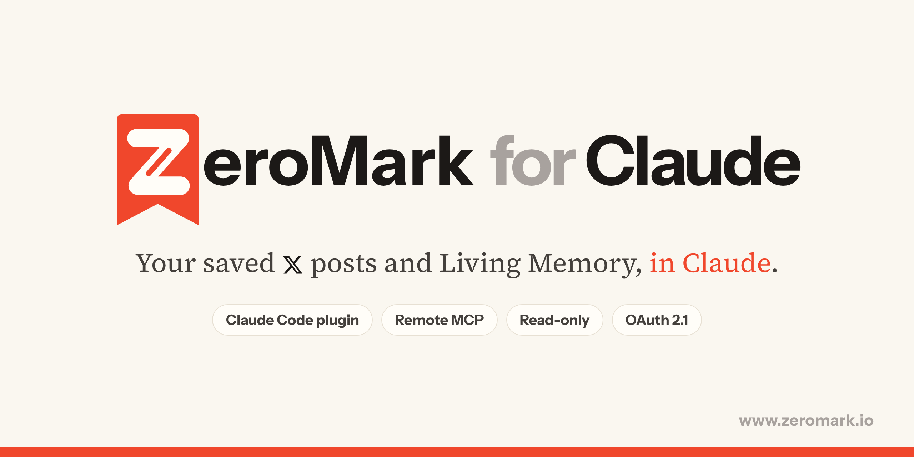

<div align="center">



# ZeroMark for Claude

**Your saved X posts and your Living Memory, inside Claude.**

[](https://github.com/asheus/zeromark-plugins/actions/workflows/validate.yml)
[](#claude-code)
[](https://modelcontextprotocol.io)
[](#privacy-and-security)
[](LICENSE)

[Website](https://www.zeromark.io) · [Privacy](https://www.zeromark.io/privacy) · [Report a bug](https://github.com/asheus/zeromark-plugins/issues/new/choose)

</div>

---

> **Coming soon.** The connector is not live on zeromark.io yet. Installing it now has nothing to connect to, and the connector guide is not published.

[ZeroMark](https://www.zeromark.io) reads every post you bookmarked on X and helps you clear the pile. The posts you mark Done become your **Living Memory**: notes that grow as you keep more.

This repository is ZeroMark's **Claude Code plugin marketplace**. It installs the ZeroMark connector, a hosted remote MCP server at `https://www.zeromark.io/api/mcp`, together with a skill that teaches Claude how to use it. The same server URL works in claude.ai, Claude Desktop, ChatGPT, Perplexity, VS Code, Cursor and any other client that speaks remote MCP.

### What you can ask

- *"What did I save about GLP-1 trials last month? Link the posts."*
- *"Which of my open saves are still worth reading, and which have gone stale?"*
- *"Summarize my Living Memory on fundraising, then tell me what I keep coming back to."*
- *"From my saves, what is the one thing worth acting on this week?"*
- *"Find that thread about pitch decks I bookmarked and pull the key points."*

Every answer can link straight back to the post on x.com.

---

## Install

### Claude Code

```text
/plugin marketplace add asheus/zeromark-plugins
/plugin install zeromark@zeromark
```

Then run `/mcp`, choose **zeromark** and sign in. A ZeroMark page asks you to approve read-only access, and you are done. There is no key to copy.

### claude.ai and Claude Desktop

1. Open **Settings → Connectors → Add custom connector**.
2. Name it `ZeroMark` and paste the server URL:

   ```text
   https://www.zeromark.io/api/mcp
   ```

3. Press **Connect**, sign in to ZeroMark and approve.

A connector added on claude.ai is also available in Claude Desktop and in the Claude mobile apps.

### VS Code and Cursor

[](https://insiders.vscode.dev/redirect/mcp/install?name=zeromark&config=%7B%22type%22%3A%22http%22%2C%22url%22%3A%22https%3A%2F%2Fwww.zeromark.io%2Fapi%2Fmcp%22%7D) [](https://insiders.vscode.dev/redirect/mcp/install?name=zeromark&config=%7B%22type%22%3A%22http%22%2C%22url%22%3A%22https%3A%2F%2Fwww.zeromark.io%2Fapi%2Fmcp%22%7D&quality=insiders) [](https://cursor.com/en/install-mcp?name=zeromark&config=eyJ1cmwiOiJodHRwczovL3d3dy56ZXJvbWFyay5pby9hcGkvbWNwIn0=)

One click adds the server. The first tool call opens ZeroMark's sign-in in your browser.

### ChatGPT

Add a custom MCP server with the URL `https://www.zeromark.io/api/mcp` ([OpenAI's steps](https://developers.openai.com/apps-sdk/deploy/connect-chatgpt)), then sign in to ZeroMark and approve. ChatGPT's deep research can use it too, through the `search` and `fetch` tools.

### Perplexity

On Pro, Max or Enterprise, add a custom remote connector with the same URL and choose OAuth ([Perplexity's steps](https://www.perplexity.ai/help-center/en/articles/13915507-adding-custom-remote-connectors)).

### Gemini CLI

Use the companion extension: [`asheus/zeromark-gemini-extension`](https://github.com/asheus/zeromark-gemini-extension).

```bash
gemini extensions install https://github.com/asheus/zeromark-gemini-extension
```

### Any other MCP client

<table>
<tr><th>Sign in with OAuth (recommended)</th><th>Use a ZeroMark key</th></tr>
<tr valign=top>
<td>

```json
{
  "mcpServers": {
    "zeromark": {
      "type": "http",
      "url": "https://www.zeromark.io/api/mcp"
    }
  }
}
```

</td>
<td>

```json
{
  "mcpServers": {
    "zeromark": {
      "type": "http",
      "url": "https://www.zeromark.io/api/mcp",
      "headers": {
        "Authorization": "Bearer ${ZEROMARK_KEY}"
      }
    }
  }
}
```

</td>
</tr>
</table>

Make a key in ZeroMark under **Settings → Connect to Claude, ChatGPT or Gemini**. Keys start with `zm_mcp_`, are shown once, and can be revoked there at any time.

```bash
claude mcp add --transport http --scope user zeromark https://www.zeromark.io/api/mcp \
  --header "Authorization: Bearer zm_mcp_YOUR_KEY"
```

---

## Tools

Eight tools, all read-only. None of them can mark a save Done, let it go, edit, delete, or touch your X account.

| Tool | What it does |
| --- | --- |
| `library_overview` | Counts by stage and field, your top voices, and how many Living Memory notes you have. A good first call. |
| `search_saves` | Search your saves by meaning and by words, with optional `status`, `since` and `until` filters. Up to 25 a page. |
| `get_save` | One save in full, by its id, its x.com URL or its post id. |
| `list_by_stage` | Your saves at one stage of their life (see below), newest first, with a cursor for the next page. |
| `get_memory` | Your Living Memory as Markdown: every note, your own thoughts on it, and its sources. |
| `weekly_question` | Asks ZeroMark which one save is worth acting on this week, and why. |
| `search` | ChatGPT's deep-research search shape over the same library. |
| `fetch` | ChatGPT's deep-research fetch shape, by id. |

Every tool carries `readOnlyHint: true`, `destructiveHint: false` and `openWorldHint: false`, so clients that honour MCP annotations will never ask you to approve a write.

### Stages

| Stage | Means |
| --- | --- |
| `fresh` | Open and saved in the last two weeks. |
| `still_useful` | Marked Done, pinned, or still current. |
| `fading` | Open and older, or past its moment. |
| `snoozed` | Hidden until a date you chose. |
| `let_go` | You let it go. |

---

## Privacy and security

- **Read-only, by design.** The server exposes no write tools, and an OAuth grant or key carries the `read` scope only.
- **Your library only.** Every call is scoped to the account that approved it. There is no way to read another reader's saves.
- **You decide, and you can undo it.** Approve each app on a ZeroMark consent page; disconnect an app or revoke a key in Settings and it stops working immediately.
- **What is logged.** Which tool ran, when, and how many rows came back. Never the question, never the content.
- **Standards.** OAuth 2.1 with PKCE (S256), dynamic client registration, protected resource metadata (RFC 9728), resource indicators (RFC 8707) and rotating refresh tokens.
- **Posts are other people's words.** Results tell the assistant that saved posts are content to read, never instructions to follow.

Full policy: [zeromark.io/privacy](https://www.zeromark.io/privacy). Found a vulnerability? See [SECURITY.md](SECURITY.md).

---

## Plans and limits

The connector is on every ZeroMark plan, the free plan included. `weekly_question` counts as one Chat question against the free plan's daily allowance; every other tool is free to call. Each key or app may make 120 calls every 15 minutes.

## Troubleshooting

| You see | Try |
| --- | --- |
| `401 Unauthorized` | Sign in again from your client (`/mcp` in Claude Code), or check the key has not been revoked. |
| The consent page warns about an unfamiliar app | It is a client ZeroMark has not seen before. Approve only if you started the connection yourself. |
| `429` or "slow down" | You passed 120 calls in 15 minutes. Wait a few minutes. |
| Empty results | Connect X in ZeroMark first, so there is a library to read. |

The connector guide will be published when this ships.

---

## Repository layout

```text
.
├── .claude-plugin/
│   └── marketplace.json          # The marketplace Claude Code reads
├── plugins/
│   └── zeromark/
│       ├── .claude-plugin/
│       │   ├── plugin.json       # Plugin manifest
│       │   └── icon.png
│       ├── .mcp.json             # Points at https://www.zeromark.io/api/mcp
│       ├── skills/
│       │   └── zeromark-library/
│       │       └── SKILL.md      # How Claude should use the tools
│       └── README.md
├── server.json                   # MCP Registry entry
└── assets/
```

The plugin holds configuration and instructions only. There is no code to run on your machine: Claude Code talks to ZeroMark's hosted server.

## Development

```bash
git clone https://github.com/asheus/zeromark-plugins
cd zeromark-plugins
claude plugin validate .
claude --plugin-dir ./plugins/zeromark
```

See [CONTRIBUTING.md](CONTRIBUTING.md).

## License

The plugin files in this repository are released under the [MIT License](LICENSE). The ZeroMark service they connect to is governed by the [ZeroMark terms](https://www.zeromark.io/terms).

<div align="center">
<sub>Made by <a href="https://www.zeromark.io">ZeroMark</a> · Tellurave LLC</sub>
</div>
